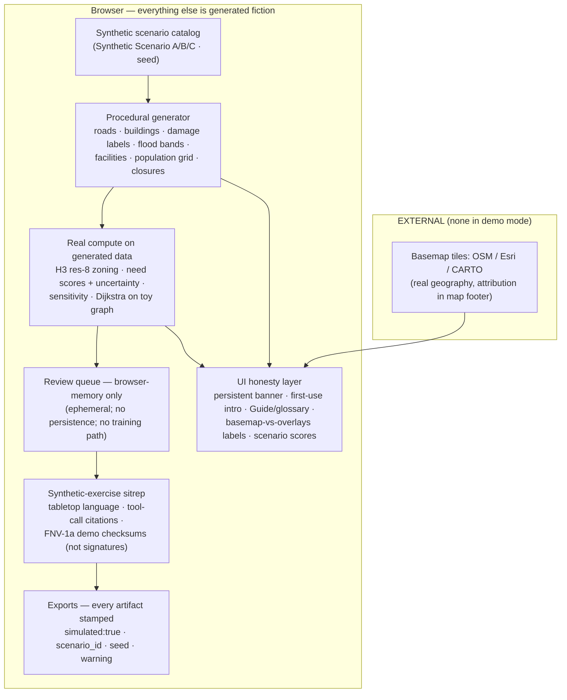
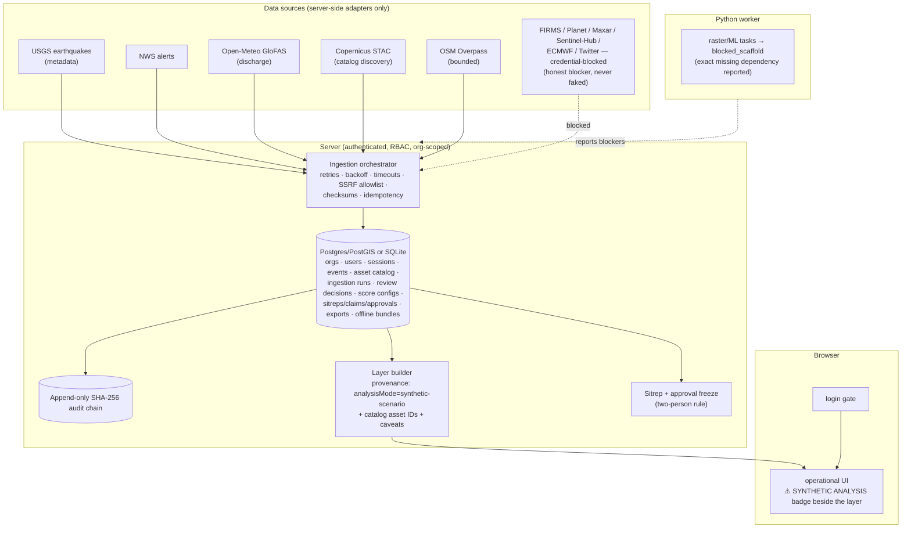
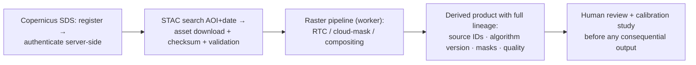

# Data flow — static demo and local pilot

> Companion to `docs/CAPABILITY_MATRIX.md` and `docs/EVIDENCE_LEDGER.md`. The two flows never mix silently: the demo cannot fetch external data, and the pilot labels its synthetic analysis layer.

## Public demo (static GitHub Pages — simulated exercise)

**Key invariants:** no network data fetch other than map tiles; same seed ⇒ identical scenario; nothing is persisted server-side; no ML model exists anywhere in this path.

## Local pilot (runnable, server-backed — real catalog + labeled-synthetic analysis)

**Key invariants:** secrets are server-side env only (never in client bundles); the analysis geometry is still the labeled synthetic scenario — the pilot never claims a processed product; the browser renders server-computed layers losslessly and composes nothing itself.

## Proposed next seam (not implemented — do not conflate with the above)

Every step above is a documented owner action in `docs/PROVIDER_STATUS.md`, not an existing capability.
